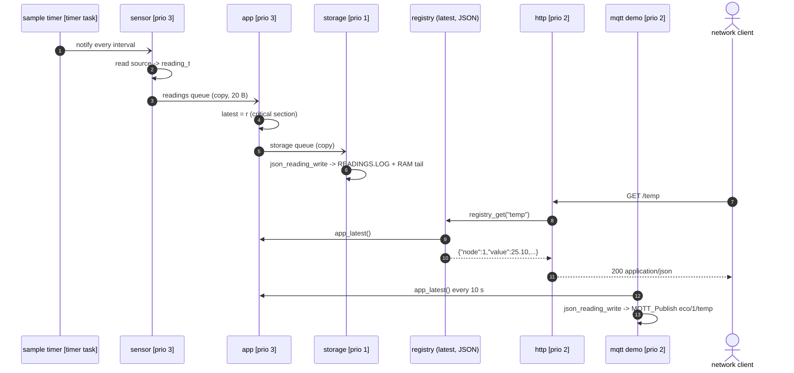

# Eco-Connect gateway - architecture and design

Subject: this repository, branch `main`. Method: the cohort's embedded architecture and design
framework, run with architecture and design as **one combined stage** between requirements and
verification. Every design statement below points at the file that implements it.
Companion documents: `docs/architecture.md` (short overview), `docs/io-layer.md` (peripheral IO),
`docs/memory-budget.md`, `docs/demos/`, `docs/steps/`.

---

## 1. How the method runs for this source

```
 REQUIREMENTS                         COMBINED ARCHITECTURE-DESIGN STAGE                  VERIFICATION
 (what and how well)                  (structure, behaviour, interfaces)                  (evidence)
 ----------------------------         ------------------------------------------          -------------------------
 R1 system boundary + actors   --->   D1 decomposition: layers, tasks, modules     --->   V1 host unit tests
 R2 requirements (brief + promises)   D2 interfaces: queue items, registry, routes,       V2 build matrix (5 variants,
 R3 use cases with extensions         frames, IO layer, store / transport contracts          0 warnings, size per variant)
 R4 constraints                       D3 data flow: reading_t -> JSON                     V3 on-board evidence (open:
 R5 quality attributes as             D4 concurrency: priorities, ownership, hand-offs       analyser, Wireshark, ping)
    measurable scenarios              D5 memory: static budget                            V4 architecture review
                                      D6 error handling: per layer                           (section 6 + open points)
                                      D7 configurability: build, config header, board
                                         table, registry
```

Why combined: the separate architecture method (problem -> object model -> CRC cards -> event model
-> runtime -> module catalog -> TDD strategy -> interfaces -> implementation -> review) and the
design bring-up method (toolchain -> build -> hardware -> drivers -> tasks -> external interface ->
persistence/integration) meet in the same artefacts on this project. The runtime is fixed by the
promise (FreeRTOS + lwIP), so "runtime selection" collapses into a justification; the object model
and the module catalog are the same list once each behaviour cluster maps to one `app/` folder;
interfaces are written once, as C headers, and tested on the host. One stage produces one module
catalog with interfaces, the task model and the budgets; verification consumes it.

Artefact map (framework artefact -> where it lives for this source):

| Framework artefact | Here |
|---|---|
| Problem statement, context diagram | section 2.1 |
| Requirements / brief goals | section 2.2 (R-table) |
| Core use case + extensions | section 2.3 (UC-1 ... UC-6) |
| Event table | section 3.4 (gateway FSM events, OTA FSM events) |
| Runtime architecture | section 3.4 (task model) |
| Module catalog | section 3.1 |
| Module interfaces | section 3.2 + the `.h` files listed there |
| TDD strategy | section 4 (pure-C modules built twice) |
| Implementation plan | `docs/steps/` (steps 00-18) + `docs/demos/` + `docs/io-layer.md` |
| Architecture review | section 6 |

---

## 2. Requirements

### 2.1 System under design and context
**System under design:** the gateway = NUCLEO-F411RE board + ENC28J60 Ethernet + W25Q flash + firmware
image. Every actor is outside it.

| Actor | Role | Channel | Goal |
|---|---|---|---|
| Network client (browser, curl, script) | primary | Ethernet / IPv4 / TCP / HTTP / JSON on :80 | read the latest reading, change the interval, read status |
| Serial host (PC tool, second MCU) | primary | USART1 115200, framed protocol | same GET/SET commands as HTTP |
| Bench engineer | primary | USART2 console (log lines) | observe and diagnose |
| Temperature sensor (I2C1) | supporting | I2C, 100 kHz | supplies readings (sensor driver = mentee task; simulated source today) |
| MQTT broker (demo) | supporting | TCP :1883 | receives published readings |
| Update server (demo) | supporting | HTTP :8080 with Range | serves the image |
| Time | trigger | - | sampling interval, keep-alive, publish interval |

The network is a channel, not an actor: link loss is an extension of a use case.

### 2.2 Requirements
Sources: the cohort project brief (goals G1-G7, written for Zephyr + BLE), the 24/25 Nov session
promises (recording offsets) and the owner decisions of 27 Nov. The brief is adapted to the promised
stack: FreeRTOS + lwIP instead of Zephyr, I2C sensor instead of BLE node.

| ID | Requirement | Source | Implemented in |
|---|---|---|---|
| R1 | Boots on NUCLEO-F411RE, ENC28J60 over SPI gets an IPv4 address and answers ping | brief G1 | `bsp/`, `app/io/` (`/SPI2/`), `drivers/enc28j60/`, `middleware/lwip_port/`, `app/net/net_init.c` |
| R2 | Sensor task reads temperature at a configurable interval (sensor driver left to mentees) | brief G2; session 1:12:47 | `app/sensor/sensor_task.c`, `app/io/io_i2c.c` (`/I2C1/`) |
| R3 | Readings travel sensor -> processing -> network/storage through RTOS queues; no heap in steady state | brief G3; session 33:19-36:30 ("messages kept in a queue, sent in order, protected by a lock") | `app/core/readings.h`, `app/core/app_task.c`, `app/storage/storage_task.c` |
| R4 | `GET /temp` returns JSON with node, value, timestamp, sequence; interval can be changed; unknown commands give a JSON error | brief G4 | `app/http/http_router.c`, `app/json/json_reading.c` |
| R5 | GET-SET registry (commands mapped to callbacks), bounded buffers, no malloc, no printf on the data path | brief G5 | `app/registry/registry.c`, `app/registry/commands.c` |
| R6 | Gateway state machine + watchdog | brief G6 | `app/core/gateway_fsm.c`, `app/core/supervisor.c`, `bsp/iwdg.c` |
| R7 | Log over the UART console with a level per module | brief G7 | `app/log/log.c` (`/UART2/`) |
| R8 | HTTP over TCP on lwIP (not FreeRTOS+TCP), trimmed server on lwIP's own API | session 58:03-59:35, 1:09:56-1:10:56, 1:12:47 | `app/http/http_server.c` (netconn) |
| R9 | FAT file system on W25Q SPI NOR for persistence | session 50:24-50:53 | `middleware/fatfs_port/diskio.c`, `drivers/w25q/` |
| R10 | Custom framed serial protocol (packet in packet) from the bare-metal Eco-Connect, on the RTOS | session 1:15:11-1:16:35, 1:20:22 | `app/proto/serial_protocol.c`, `app/proto/proto_task.c` (`/UART1/`) |
| R11 | Application code separated from platform, liftable to Zephyr later | session 1:12:47 | pure-C modules (section 4), `app/io/` board table + drivers vs `app/` behaviour |
| R12 | Optional demos selectable at build time without changing the default firmware: TCP echo, MQTT publish, IO API demo, OTA download | owner decision; session lists MQTT as out of the core path (58:03) | `Makefile` `DEMO=`, `app/config/app_config.h`, `app/demos/`, `app/mqtt/`, `app/ota/` |
| R13 | One peripheral IO API for the whole project in the FreeRTOS+IO API style: open by path, read/write/ioctl, per-board descriptor table, polled / circular buffer / zero copy / character queue modes, static memory only | owner decision 27 Nov | `app/io/`, `docs/io-layer.md` |
| R14 | OTA demo build at or below 75 % of the 128 KB RAM with margin | owner decision 27 Nov | `app/config/app_config.h` (OTA section), `app/ota/ota_storage_fatfs.c`, `storage_call()` in `app/storage/storage_task.c` |

### 2.3 Use cases (intent level; extensions are the test conditions)

**UC-1 Report latest temperature** (core use case, input -> processing -> storage -> output)
- Primary: network client or serial host. Supporting: sensor. Trigger: client request; steps 1-2 repeat every `interval`.
- Precondition: IPv4 address held (HTTP) or link idle (serial).
- Minimal guarantee: the gateway keeps answering while the sensor fails; a failed read is marked, never shown as fresh.
- Main: 1 sensor supplies a reading; 2 gateway stamps (seq, ms) and keeps it as latest, appends it to the log;
  3 client asks; 4 gateway returns the latest reading as JSON.
- Extensions: 1a read fails -> reading carries `"status":"sensor_error"` with the last good value;
  2a readings queue full -> oldest dropped and counted (`dropped` in `GET status`);
  2b storage queue full -> line skipped, logged at debug; 2c no media -> RAM tail only;
  3a unknown key / route -> JSON error (404); 3b malformed or oversized request -> 400 / 413;
  3c serial bytes arrive faster than the protocol task reads -> `/UART1/` RX ring full, bytes dropped and counted (`rx_overruns`);
  4a no reading yet -> 503 `{"error":"no data","key":"temp"}`; *a task hang -> UC-4.
- Trace: R2-R5, R8, R10; `tests/test_json.c`, `test_registry.c`, `test_http.c`, `test_serial_protocol.c`, `test_io.c`.

**UC-2 Change the sampling interval / node id / log level**
- Primary: network client (`POST /interval {"interval_ms":5000}`) or serial host (`SET interval 5000`).
- Main: 1 client sends the new value; 2 gateway validates the range (100..60000 ms); 3 gateway applies it and answers with the new value.
- Extensions: 2a out of range / not a number -> 400 / `ERR` frame, value unchanged.
- Trace: R4, R5; `app/registry/commands.c` (`set_interval`, `set_node`, `set_log`).

**UC-3 Keep a reading history**
- Primary: bench engineer (reads `GET /log`). Trigger: every reading.
- Main: 1 gateway appends each reading as a JSON line to `READINGS.LOG`; 2 rotates at 256 KB; 3 serves the last 8 from RAM.
- Extensions: 1a W25Q absent or data path not written -> "no media, logging off", RAM tail still served.
- Trace: R9; `app/storage/storage_task.c`.

**UC-4 Recover from a firmware hang**
- Stakeholder: device owner. Trigger: a task stops checking in.
- Main: 1 supervisor sees a missed window; 2 state machine enters FAULT, logs `task <name> missed`; 3 supervisor stops feeding;
  4 IWDG resets within 2 s; 5 boot logs "last reset by the watchdog".
- Extensions: 1a the supervisor itself starves -> no feed -> same reset (supervisor runs at the lowest app priority on purpose).
- Trace: R6; `app/core/supervisor.c`, `bsp/iwdg.c`, `tests/test_fsm.c`.

**UC-5 Publish readings to a broker** (demo, `DEMO=mqtt`)
- Supporting: MQTT broker over TCP. Trigger: publish interval (10 s).
- Main: 1 gateway connects (clean session, keep-alive 60 s); 2 every interval publishes the latest reading JSON to `eco/<node>/temp`; 3 broker acknowledges (QoS 1).
- Extensions: 1a broker unreachable -> retry with 2 s..60 s back-off; 2a no reading yet -> nothing published; 3a link drops -> disconnect, back-off, reconnect.
- Trace: R12; `app/mqtt/mqtt_demo.c`, `app/mqtt/mqtt_transport_lwip.c`.

**UC-6 Download and verify a firmware image** (demo, `DEMO=ota`)
- Primary: operator (serial or HTTP). Supporting: update server. Trigger: `SET ota start <crc32>` / `POST /ota`.
- Minimal guarantee: the running firmware is never touched; a bad or partial image ends in FAILED with a reason.
- Main: 1 operator sets the URL and expected CRC; 2 gateway learns the size from the first block; 3 fetches every 512-byte
  block (any order) into `OTA.BIN` on the FatFs volume; 4 verifies size and CRC32; 5 reports READY.
- Extensions: 2a size 0 / over limit (256 KB) -> FAILED (empty / too large); 3a request fails 3 times -> FAILED (transport);
  3b wrong block length or duplicate -> rejected / ignored, requested again; 3c operator aborts -> FAILED (aborted);
  3d volume not mounted (W25Q data path not written yet) -> FAILED (storage error); 4a CRC differs -> FAILED (crc mismatch).
  Out of scope: install, bootloader, rollback (needs two slots + confirm after self-test).
- Trace: R12, R14; `app/ota/*`, `tests/test_ota.c`, `tests/test_ota_http.c`.

### 2.4 Constraints
| Kind | Constraint | Consequence in the design |
|---|---|---|
| Hardware | STM32F411RE: 512 KB flash, 128 KB RAM, no Ethernet MAC | ENC28J60 on SPI2; RAM is the scarce resource (69 % used by the default build) |
| Hardware | ENC28J60: 8 KB buffer, no checksum offload, errata on RX pointers | software checksums in lwIP (`lwipopts.h`), RX task above tcpip (prio 5) to drain the FIFO |
| Hardware | SPI2 shared by ENC28J60 and W25Q | `/SPI2/` in zero-copy mode: one bus mutex (priority inheritance) + one chip-select index per device (`app/io/io_board_f411.h`) |
| Software | FreeRTOS V11.1.0, lwIP 2.2.0 netconn (`LWIP_SOCKET 0`), no DNS, no TLS | every network module uses netconn; hosts are IPv4 literals; MQTT/OTA on trusted LAN only |
| Software | no heap in steady state; FreeRTOS heap_4 16 KB only for lwIP mailboxes | static tasks, queues, buffers and IO control blocks everywhere (`xTaskCreateStatic`, `xQueueCreateStatic`, `io_board.c`) |
| Software | no printf on the data path | own JSON writer (`json_writer.c`), log lines formatted into the log queue entry |
| Software | FatFs built non-reentrant (`FF_FS_REENTRANT 0`) | the storage task is the only FatFs caller; other tasks hand it a job with `storage_call()` |
| Process | the I2C sensor driver and the W25Q data path are mentee tasks | contracts in headers + stubs returning `NOT_READY`; the rest of the system degrades, never blocks |
| Process | compile-check only, no hardware yet | evidence V3 is open; host tests carry the logic verification |
| Process | public template repo, mentees follow commits | small logical commits; vendored code unmodified with licences (`third_party/README.md`); the IO layer is own code in the FreeRTOS+IO API style |

### 2.5 Quality attributes (scenario form: stimulus -> response -> measure)
| QA | Scenario | Design answer | Measure / status |
|---|---|---|---|
| Reliability | a task blocks forever | supervisor windows + FSM FAULT + IWDG | reset <= window + 2 s; `test_fsm.c` 46 checks; not measured on hardware |
| Timeliness | network, peer or bus stalls | every blocking call has a timeout (recv 1-5 s, send 2 s, accept 1 s, bus mutex 50 ms, UART TX 100-1000 ms) | code review of each task loop (section 3.4); IO timeouts in the board table |
| Resource use | default build | static budget | 98,572 B flash (18.8 %), 90,216 B RAM (68.8 %) |
| Resource use | OTA demo build | FatFs store, 512 B blocks, 2 KB task stack | 94,040 B RAM (71.7 %), was 111,504 B (85.1 %) |
| Consistency | same command on HTTP and serial | one registry; the router and the protocol task call the same `registry_get/set` | `test_registry.c`, `test_http.c` |
| Modifiability | add an output path (MQTT) | data stays `reading_t` until `json_reading.c`; new consumer calls `app_latest()` | MQTT demo added with zero edits to core modules |
| Modifiability | add a peripheral or a board | one line in the board table; drivers take pins, IRQs and defaults from it | `docs/io-layer.md` "Adding things" |
| Configurability | choose a demo / endpoint / store without touching code | `make DEMO=`, `OTA_STORE=`, `EXTRA_DEFS=`, `app_config.h` `#ifndef` defaults, runtime registry keys | 5 build variants |
| Portability | lift app logic to Zephyr or another MCU | pure-C modules with no RTOS/HAL includes, built for host and target; IO core and modes host-built against FreeRTOS stand-ins | 8 host test programs, 926 checks |
| Testability | change JSON / protocol / FSM / IO rules | host tests with `-Werror -Wconversion` | `make test` |
| Observability | diagnose in the field | per-module log levels at run time (`SET log net debug`), counters in `GET status`, IO statistics (`IO_IOCTL_GET_STATS`) | - |
| Security | LAN attacker | none beyond input validation and bounded parsers; OTA checks integrity (CRC32), not authenticity | open point (section 6) |

---

## 3. Combined architecture-design stage

### 3.1 Decomposition: layers and module catalog
```
 app/          behaviour: tasks, protocol, registry, JSON, HTTP, storage policy, FSM, demos
 app/io/       peripheral IO: open/read/write/ioctl by path, board table, UART/SPI/I2C drivers, modes
 middleware/   glue between stacks and drivers: lwIP netif + port, FatFs diskio
 drivers/      devices on the IO layer: ENC28J60, W25Q
 bsp/          board: startup, linker script, clocks, LED/button, ENC28J60 INT/RESET, interrupts, IWDG, HAL tick
 third_party/  vendored, unmodified: CMSIS, HAL, FreeRTOS, lwIP, FatFs, coreMQTT
```
Rules: every UART, SPI and I2C access goes through `app/io/io.h`; `drivers/` never include lwIP or
FatFs; peripheral pins, IRQ priorities and defaults exist only in the board table.

| Module | Responsibility | Pattern | Pure C | Files |
|---|---|---|---|---|
| io core | open by path, request checks, mode rules, dispatch, statistics | facade over a descriptor table; driver interface (`io_driver_t`) | yes (host-built) | `app/io/io_core.c`, `io.h`, `io_driver.h` |
| io modes | polled wait, RX circular buffer, character queue, zero-copy write mutex | strategy per direction | yes (host-built with stubs) | `app/io/io_mode_*.c` |
| io drivers | USART1/2/6, SPI1-5, I2C1-3 of the F411; ISRs | one driver per type, instance from the table | no | `app/io/io_uart.c`, `io_spi.c`, `io_i2c.c` |
| io board | descriptor table, static memory, chip-select names | X-macro table | - | `app/io/io_board_f411.h`, `io_board.c` |
| sensor | sample on a timer, push `reading_t`, drop-oldest | singleton task + software timer | no | `app/sensor/sensor_task.c` |
| app | keep latest reading, fan out to storage, post FSM events | singleton task, critical-section copy | no | `app/core/app_task.c` |
| json | heap-free writer/parser, reading <-> JSON | object (`json_writer_t`) | yes | `app/json/*` |
| registry | key -> get/set callbacks, JSON results/errors | table of callbacks (command) | yes | `app/registry/registry.c`, `commands.c` |
| http | parse, route, respond; netconn server task | router table | router/response: yes | `app/http/*` |
| proto | framed serial protocol + task on `/UART1/` | state machine decoder | codec: yes | `app/proto/*` |
| storage | JSON lines to FatFs, RAM tail, `storage_call()` jobs | singleton task, sole FatFs caller, job queue | no | `app/storage/storage_task.c` |
| gateway FSM + supervisor | state from conditions, task windows, IWDG feed | state machine, watchdog supervisor | FSM: yes | `app/core/gateway_fsm.c`, `supervisor.c` |
| log | level filter, queue, log task on `/UART2/` | singleton, non-blocking producer | no | `app/log/log.c` |
| net | lwIP start, netif, link/IP status | - | no | `app/net/net_init.c`, `middleware/lwip_port/*` |
| ENC28J60, W25Q | device drivers on `/SPI2/` | bus-mutex client, own chip select | no | `drivers/enc28j60/*`, `drivers/w25q/*` |
| demo: tcp_echo | echo server | singleton task | no | `app/demos/tcp_echo.c` |
| demo: mqtt | publish latest reading; coreMQTT transport | adapter (transport interface) | no | `app/mqtt/*` |
| demo: plusio | exercises the IO API on all four peripherals | client of the IO layer | no | `app/demos/plusio_demo.c` |
| demo: ota | FSM, reassembly, CRC, store interface, HTTP Range | state machine, virtual API (`ota_storage_t`), strategy (FatFs / RAM store) | core: yes | `app/ota/*` |

### 3.2 Interfaces (the contracts other modules depend on)
| Interface | Shape | Defined in |
|---|---|---|
| reading item | `reading_t` 20 B by value: seq, node, status, value_centi (0.01 degC), timestamp_ms | `app/core/readings.h` |
| readings queue | static FreeRTOS queue, depth 8, producer sensor, consumer app, full = drop oldest | `app/sensor/sensor_task.c` |
| latest reading | `bool app_latest(reading_t *out)` - copy under critical section | `app/core/app_task.h` |
| registry entry | `{key, help, get(json_writer_t*,ctx), set(const char*,ctx), ctx}`, max 16 keys | `app/registry/registry.h` |
| registry calls | `registry_get/set/list` -> complete JSON object or `{"error":..,"key":..}`; `reg_status_t` -> HTTP code map | `registry.h`, `http_router.c: reg_to_http()` |
| JSON reading | `{"node":1,"value":25.10,"timestamp":12345,"seq":12}` (+ `"status":"sensor_error"`), <= 112 B | `app/json/json_reading.h` |
| HTTP | routes `/`, `/temp`, `/interval` (GET/POST), `/status`, `/version`, `/log`, `/ota` (ota demo) | `app/http/http_router.c` |
| serial frame | `$ BODY * CS`, inner `OP TYPE LL VALUE`, `/` escape, one's-complement checksum | `app/proto/serial_protocol.h` |
| supervisor | `sup_register(name, window_ms)`, `sup_checkin(id)`, `gw_post(event)` | `app/core/supervisor.h` |
| peripheral IO | `io_open(path, 0)`, `io_read/io_write(h, buf, len)` -> bytes, `io_ioctl(h, request, value)` -> `io_status_t`; paths `/UART1/`, `/UART2/`, `/SPI2/`, `/I2C1/` | `app/io/io.h`, `docs/io-layer.md` |
| IO driver | `io_driver_t {open, write, read, ioctl, mode_changed}`; board entry `io_desc_t` | `app/io/io_driver.h` |
| shared SPI bus | `OBTAIN_WRITE_MUTEX` -> `SPI_SELECT(cs)` -> write/read/`SPI_TRANSFER` -> `SPI_DESELECT` -> `RELEASE_WRITE_MUTEX` | `app/io/io_spi.c`, `drivers/w25q/w25q.c: cmd()` |
| storage job | `bool storage_call(fn, arg, &result, timeout_ms)` - runs `fn(arg)` in the storage task | `app/storage/storage_task.h` |
| OTA store | `ota_storage_t {open, write(off), read, close, abort, capacity, ctx}` | `app/ota/ota_storage.h` |
| OTA events | `ota_fsm_post(REQUEST/BEGIN/BLOCK/VERIFY/ERROR/ABORT/RESET)` | `app/ota/ota_fsm.h` |
| MQTT transport | coreMQTT `TransportInterface_t {recv, send}` over `struct NetworkContext` (netconn + pending netbuf) | `app/mqtt/mqtt_transport_lwip.h` |
| demo hook | `void demo_start(void)` - one per build, called from `main()` | `app/demos/demo.h` |

### 3.3 Data flow

The reading is a fixed-size struct by value until one of the three formatters calls
`json_reading_write()` / `json_reading_members()`: HTTP and serial through the registry, storage and
MQTT directly. One formatter means the payload cannot diverge between interfaces.

Serial path through the IO layer: USART1 RXNE interrupt -> `/UART1/` RX ring (512 B) + semaphore ->
`io_read()` in the protocol task -> frame decoder -> registry -> `io_write()` (polled, 100 ms).
Console path: any task -> log queue -> log task -> `io_write()` on `/UART2/` -> 512-character TX
queue -> TXE interrupt.

OTA store path: OTA task -> `ota_storage_t` FatFs store -> `storage_call()` job -> storage task ->
FatFs -> `diskio.c` -> W25Q -> `/SPI2/` (bus mutex, chip select 1).

### 3.4 Concurrency: task model, ownership and events
| Prio | Task | Stack (words) | Trigger | Supervisor window | Owner of |
|---|---|---|---|---|---|
| 6 | timer service | FreeRTOS | software timers | - | sample timer |
| 5 | enc_rx | 512 | EXTI4 notify | not registered (feeds tcpip, which is probed) | ENC28J60 RX path |
| 4 | tcpip (lwIP) | 512 (2048 B) | mailbox | 3 s (callback probe) | lwIP core (core locking) |
| 3 | sensor | 384 | timer notify | 3 s | sensor source (`/I2C1/` with `SENSOR=i2c`) |
| 3 | app | 512 | readings queue | 3 s | latest reading |
| 2 | http | 1024 | accept (1 s timeout) | 8 s | TCP :80 |
| 2 | proto | 768 | `/UART1/` RX ring (1 s RX timeout) | 3 s | `/UART1/` (single reader and writer) |
| 2 | demo (one of echo / mqtt / pio / ota) | 1024 (ota: 512) | per demo | 8 / 30 / 3 / 30 s | its socket / buffers |
| 1 | storage | 768 | storage queue (readings and `storage_call()` jobs) | 30 s | FatFs (sole caller, non-reentrant build) |
| 1 | log | 256 | log queue | 3 s | `/UART2/` TX (single writer after the scheduler starts) |
| 1 | hb | 384 | periodic (100 ms blink in FAULT) | 2 s | LD2 |
| 1 | supervisor | 512 | 250 ms + event queue | - | IWDG feed, gateway FSM |

Ownership rules (each shared resource has exactly one owner, others go through a queue, a copy or the
mutex): console TX = log task; `/UART1/` = proto task; FatFs = storage task (the OTA store sends jobs);
latest reading = app task (readers copy under a 20-byte critical section); `/SPI2/` = whoever holds the
bus mutex, one chip select at a time (ENC28J60 from enc_rx / tcpip, W25Q from storage); OTA state = OTA
task (setters queue commands, getters read a snapshot). ISR hand-offs are signal-only: EXTI4 -> task
notify; USART1 RXNE -> RX ring + semaphore; USART2 TXE <- TX character queue; no blocking and no
logging inside ISRs.

`storage_call()` contract: one job at a time (caller mutex); the job waits in the same queue as the
readings; a job not started within the timeout is cancelled and never runs; a started job is always
waited for, so its arguments (kept in the store object, not on the caller's stack) stay valid.

Gateway FSM (`app/core/gateway_fsm.c`): states IDLE, SAMPLING, CONNECTED, REPORTING, FAULT derived
from conditions set by events READING_OK/FAIL, LINK_UP/DOWN, REPORT, REPORT_IDLE, TASK_STALL.
OTA FSM (`app/ota/ota_fsm.c`): IDLE -> REQUESTED -> DOWNLOADING -> VERIFYING -> READY / FAILED; invalid
events are ignored and change nothing.

IO modes per peripheral (board defaults, `app/io/io_board_f411.h`):

| Path | TX | RX | Why |
|---|---|---|---|
| `/UART1/` | polled, 100 ms | circular buffer 512 B | one writer; bytes must never be lost while the task is busy decoding |
| `/UART2/` | character queue 512 | polled (unused; char queue in `DEMO=plusio`) | the log task copies a line and goes on, the TXE interrupt sends it |
| `/SPI2/` | zero copy (bus mutex) | polled | two devices, two tasks; multi-cycle sequences under one lock |
| `/I2C1/` | polled | polled | one user (sensor task) |

### 3.5 Memory
| Build | Flash | RAM | Delta vs none | Main RAM items |
|---|---|---|---|---|
| none | 98,572 B | 90,216 B | - | lwIP pools (PBUF 10 x 1536, MEM 10 KB), heap_4 16 KB, task stacks, log queue 16 x 122 B, IO table 2.5 KB |
| tcp_echo | 99,200 B | 94,416 B | +628 / +4,200 | 4 KB task stack |
| mqtt | 114,924 B | 95,128 B | +16,352 / +4,912 | coreMQTT code, 512 B packet buffer, 4 KB stack |
| plusio | 100,048 B | 94,408 B | +1,476 / +4,192 | 4 KB stack |
| ota | 106,732 B | 94,040 B | +8,160 / +3,824 | 2 KB stack, 512 B block, 512 B head buffer, FatFs store object, 64 B block bitmap |

History of the two changes since the step-18 build (`DEMO=none` 91,152 / 88,840):
- OTA RAM trim: `DEMO=ota` 111,504 B -> 92,888 B RAM before the IO layer, 94,040 B with it. The 16 KB
  RAM image store is no longer the default (FatFs file, `make DEMO=ota OTA_STORE=ram` keeps the RAM
  store for the bench), blocks 1024 -> 512 B, OTA stack 4 KB -> 2 KB (static estimate ~1.1 KB worst
  case, `docs/demos/ota.md`). The storage task's job path costs +176 B flash / +216 B RAM in every build.
- IO layer: +7,244 B flash (IO layer ~7.1 KB + HAL I2C 2.9 KB - ~2.8 KB of replaced drivers),
  +1,160 B RAM (control blocks with write mutex, HAL handles, 64 B console RX reserve; the 512 B
  console TX and 512 B link RX buffers existed before).

Rules: no `malloc` in app code; FreeRTOS heap only for lwIP's per-connection mailboxes; every buffer
has a compile-time size; a buffered IO mode exists only where the board table reserves its memory.

### 3.6 Error handling (policy per layer)
| Layer | Policy | Example |
|---|---|---|
| IO layer | every request checked before it runs; status per call; short counts explained by `GET_LAST_STATUS`; never blocks without a timeout | `io_status_t` (`PARAM`, `UNSUPPORTED`, `NO_MEMORY`, `STATE`, `NOT_OWNER`, `TIMEOUT`, `IO`, `NOT_READY`); I2C bus recovery on bus errors |
| Device driver | return a status, map IO errors, never block without timeout | `enc_status_t`, `w25q_status_t` (`NOT_READY` from the mentee stubs) |
| Queue hand-off | full -> drop and count, never block the producer | sensor drops the oldest; log drops the line (`log_dropped`); UART RX ring full -> `rx_overruns` |
| Parser | bounded input, explicit error codes | `json_status_t`, `http_parse_t` (413 above 1 KB), `proto_status_t`, `ota_head_status_t` |
| Registry / interface | errors are JSON objects, mapped to HTTP codes | `REG_ERR_UNKNOWN` -> 404, `VALUE` -> 400, `NO_DATA` -> 503 |
| Network task | timeouts on accept/recv/send, close and continue | http 3 s request timeout; echo 10 s idle; MQTT back-off 2-60 s |
| Long operation | own state machine with a reason | OTA `FAILED` + `ota_reason_t` (transport, storage, crc mismatch, too large, ...) |
| System | missed check-in -> FAULT -> no feed -> IWDG reset; reset cause logged at boot; fault hooks print through `io_panic_puts()` | `supervisor.c`, `main.c`, `rtos_hooks.c` |

### 3.7 Configurability
| Level | Mechanism | Items |
|---|---|---|
| Build | `make` variables (also `build.ps1 -Demo`) | `DHCP=1`, `SENSOR=i2c`, `WATCHDOG=0`, `DEMO=none/tcp_echo/mqtt/plusio/ota`, `OTA_STORE=fatfs/ram`, `EXTRA_DEFS="-DNAME=value"` |
| Board | `app/io/io_board_f411.h` (selected by `app/io/io_board.h`) | paths, pins, IRQ priorities, default speeds, transfer modes, timeouts, static reserves, SPI chip selects |
| Compile-time constants | `app/config/app_config.h` (demos), `lwipopts.h`, `FreeRTOSConfig.h`, `ffconf.h`, `net_init.h` | broker host/port/topic/QoS/keep-alive/interval, echo port, OTA URL/block/max size/store/stack |
| Run time | registry keys; IO ioctls | `interval`, `node`, `log`, `ota_url`, `ota`; mode, speed, timeout per peripheral |

`DEMO=none` adds no define, source or include path, so the demos are an extension of the
architecture, not a fork of it. Each demo obeys the same rules as the core tasks: static allocation,
bounded blocking, supervisor check-ins, `demo` log tag (exists only in demo builds), state and
commands through the registry.

---

## 4. Verification plan and status
| Evidence | What it proves | Status |
|---|---|---|
| Host tests (`tests/`, host gcc, `-Werror -Wconversion -Wshadow`) | JSON, protocol, registry, HTTP router, gateway FSM, OTA FSM/reassembly/CRC/store, OTA HTTP parsing and `/ota` route, IO core and transfer modes | 8 programs, 926 checks pass (`test_io` 394) |
| Build matrix | each variant compiles with 0 errors, 0 warnings in project code; size recorded | 5/5: none, tcp_echo, mqtt, plusio, ota |
| OTA RAM budget | R14 | `DEMO=ota` 94,040 B = 71.7 % (limit 75 % = 98,304 B) |
| Logic analyser: ENC28J60 init over SPI; W25Q JEDEC under the shared bus | R1, `/SPI2/` sharing | open (hardware) |
| Wireshark: full HTTP request/response; MQTT publish; OTA Range exchange | R4, UC-5, UC-6 | open |
| Console and link on the board: boot banner, log lines, framed GET/SET, `DEMO=plusio` key echo | R7, R10, R13 | open |
| Fault demo: block a task / pull the sensor | UC-4, UC-1 ext. 1a | open |
| Stack high-water marks (OTA task logs its own after each download) | R14 stack figure | open |

TDD scope: every module without RTOS/HAL includes is compiled twice (target + host). The IO core and
mode modules use FreeRTOS calls but no HAL; they are host-built against the stand-ins in
`tests/stubs/`. The modules with HAL or network calls (drivers, tasks, transports) are kept thin so
the logic they would contain sits in a tested module (e.g. `ota_task.c` only sequences `ota_fsm.c` +
`ota_http_msg.c`; `io_uart.c` only moves bytes between registers and the mode objects).

---

## 5. Traceability matrix
| Req | Use case | Design element | Files | Verification |
|---|---|---|---|---|
| R1 | UC-1 pre | netif, `/SPI2/`, ENC28J60 driver | `drivers/enc28j60/`, `app/io/io_spi.c`, `middleware/lwip_port/ethernetif_enc28j60.c` | build; ping (open) |
| R2 | UC-1 s1 | sensor task + timer, `/I2C1/` | `app/sensor/sensor_task.c`, `app/io/io_i2c.c` | build; sensor driver open |
| R3 | UC-1 s2 | readings + storage queues, latest copy | `app/core/readings.h`, `app_task.c`, `storage_task.c` | review; load test (open) |
| R4 | UC-1, UC-2 | router, JSON reading | `app/http/http_router.c`, `app/json/json_reading.c` | `test_http.c`, `test_json.c` |
| R5 | UC-1, UC-2 | registry | `app/registry/*` | `test_registry.c` |
| R6 | UC-4 | FSM, supervisor, IWDG | `app/core/*`, `bsp/iwdg.c` | `test_fsm.c`; fault demo (open) |
| R7 | all | log module, `/UART2/` character-queue TX | `app/log/*`, `app/io/io_uart.c` | review; `test_io.c` (char queue) |
| R8 | UC-1 | netconn HTTP server | `app/http/http_server.c` | build |
| R9 | UC-3 | FatFs on W25Q | `app/storage/`, `middleware/fatfs_port/`, `drivers/w25q/` | build; W25Q data path open |
| R10 | UC-1, UC-2 | framed protocol, `/UART1/` RX ring | `app/proto/*`, `app/io/io_mode_circ_buf.c` | `test_serial_protocol.c`, `test_io.c` |
| R11 | - | pure-C split, board table | `app/json`, `app/registry`, `app/http/http_router.c`, `app/core/gateway_fsm.c`, `app/ota/` core, `app/io/io_core.c` + modes | host builds |
| R12 | UC-5, UC-6 | DEMO switch, config header, demo modules | `Makefile`, `build.ps1`, `app/config/app_config.h`, `app/demos/`, `app/mqtt/`, `app/ota/` | build matrix; `test_ota*.c` |
| R13 | all | IO layer | `app/io/*`, users in section 3.2 | `test_io.c`; build matrix; board evidence (open) |
| R14 | UC-6 | FatFs store via `storage_call()`, block and stack sizes | `app/ota/ota_storage_fatfs.c`, `app/storage/storage_task.c`, `app/config/app_config.h` | size of `DEMO=ota`; `test_ota.c` |

---

## 6. Review: open decisions and risks
1. Security: HTTP, serial, MQTT and OTA accept commands from anyone on the LAN. OTA verifies integrity
   only. Next: signed images (ECDSA over SHA-256) before any install path; a TLS stack adds tens of KB
   of flash and RAM (estimate, not measured here) against about 40 KB of free RAM in the default build.
2. RAM headroom: 68.8 % default, 71.7-72.6 % with a demo. The OTA image goes to the FatFs file, not RAM;
   the RAM store (`OTA_STORE=ram`, 83 %) is a bench option only.
3. OTA store availability: the FatFs store needs the W25Q data path (mentee task); until then an OTA
   download ends in `storage error`. Verification reads the image back in 64-byte jobs through the
   storage task (about 4,096 jobs for 256 KB): correct, not fast.
4. Install path for OTA: bootloader + two slots + confirm-after-self-test for rollback (the "reset before
   confirm is the rollback" rule). Not started.
5. IO layer on hardware: compiled and host-tested only. SPI and I2C are polled (no DMA); UART zero copy
   is implemented but no default user selects it; the console now waits at most 1 s when its 512-character
   queue is full (before: until space was free). The I2C bus recovery path is unexercised.
6. Timing figures are design values, not measurements: SYN timeout ~20 s (lwIP 6 retries at 3 s), supervisor
   windows, HTTP and IO timeouts, the OTA stack estimate. Each needs a measured value from the board.
7. Brief vs promise: the brief asks for Zephyr + BLE; the promised template is FreeRTOS + lwIP + I2C.
   Lifting to Zephyr is planned through the pure-C modules; the task layer is rewritten, and the IO
   layer's board table + drivers are the part that changes per platform.

---

## 7. Repository files this document describes
- Build and configuration: `Makefile`, `build.ps1`, `app/config/app_config.h`, `app/FreeRTOSConfig.h`,
  `middleware/lwip_port/lwipopts.h`, `middleware/fatfs_port/ffconf.h`
- Core: `app/main.c`, `app/core/readings.h`, `app/core/app_task.c/.h`, `app/core/gateway_fsm.c/.h`, `app/core/supervisor.c/.h`
- Interfaces: `app/json/json_reading.c/.h`, `app/registry/registry.h`, `app/registry/commands.c/.h`, `app/http/http_router.c/.h`,
  `app/http/http_server.c`, `app/proto/proto_task.c`, `app/proto/serial_protocol.h`
- Storage and log: `app/storage/storage_task.c/.h`, `app/log/log.c/.h`, `middleware/fatfs_port/diskio.c`
- IO layer: `app/io/io.h`, `io_driver.h`, `io_mode.h`, `io_core.c`, `io_mode_*.c`, `io_uart.c`, `io_spi.c`, `io_i2c.c`,
  `io_stm32f4.h`, `io_board.h`, `io_board_f411.h`, `io_board.c`
- Devices and board: `drivers/enc28j60/*`, `drivers/w25q/*`, `bsp/board.c/.h`, `bsp/stm32f4xx_it.c`, `bsp/iwdg.c`
- Demos: `app/demos/*`, `app/mqtt/*`, `app/ota/*`
- Tests: `tests/Makefile`, `tests/test_*.c`, `tests/stubs/*`
- Notes: `docs/architecture.md`, `docs/io-layer.md`, `docs/memory-budget.md`, `docs/demos/*.md`, `docs/steps/*.md`
