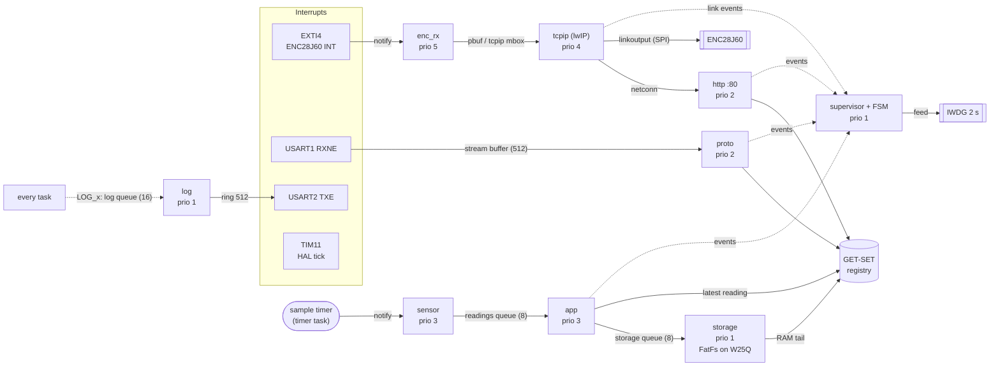

# Architecture

## 4C map
| C | In this repo |
|---|---|
| CHIP | STM32F411RE @ 100 MHz, ENC28J60 + W25Q on SPI2, I2C1 sensor, USART1 link, USART2 console, IWDG |
| CORE | FreeRTOS tasks, static queues, gateway state machine, supervisor, GET-SET registry |
| COMM | Ethernet/IPv4/TCP/HTTP/JSON (lwIP), framed serial protocol, SPI, I2C |
| CUSTOMER | `GET /temp`, `POST /interval`, `GET /log` from a browser or a script; serial GET/SET |

## Tasks, queues and interrupts

Every task in the picture checks in with the supervisor (dashed lines are events, not data).

## Data path of one reading
1. The software timer fires every `interval` ms and notifies the sensor task.
2. The sensor task reads the source (simulated, or I2C after the mentee task) and pushes a
   20-byte `reading_t` into the readings queue (full: drop the oldest, count it).
3. The app task keeps it as "latest", forwards a copy to the storage queue, posts
   `reading_ok/fail` to the state machine and logs it.
4. `GET /temp` (HTTP task) and `GET temp` (serial) each call `registry_get("temp")`, which
   copies "latest" under a short critical section and writes JSON into a static buffer.
5. The storage task appends the JSON line to `READINGS.LOG` and keeps a RAM tail for `GET /log`.

No heap is used on this path; all buffers are static and bounded. No printf on it either:
the log module formats into its own queue entry, the JSON writer formats numbers itself.

## Priorities (higher number runs first)
| Prio | Task | Why |
|---|---|---|
| 6 | timer service | FreeRTOS software timers (sample timer) |
| 5 | enc_rx | empty the 6.5 KB chip FIFO before it overflows |
| 4 | tcpip | lwIP core |
| 3 | sensor, app | the data path |
| 2 | http, proto | clients |
| 1 | log, hb, storage, supervisor | background; supervisor last on purpose (starvation -> reset) |

NVIC: USART1 5, EXTI4 6, USART2 7, TIM11 15 (all at or below the FreeRTOS syscall limit 5).
The USART priorities are set in the IO board table (`app/io/io_board_f411.h`).

## Interfaces
- HTTP: see `app/http/http_router.h` (routes, JSON errors).
- Serial: see `app/proto/serial_protocol.h` (outer frame, inner packet, checksum).
- Registry keys: see `app/registry/commands.h`.

## Layers
`app/` uses `drivers/` and `middleware/`; every UART, SPI and I2C access goes through the IO
layer `app/io/` (open by path, read/write/ioctl, board table `app/io/io_board_f411.h`, see
`docs/io-layer.md`); the device drivers in `drivers/` (ENC28J60, W25Q) use the IO layer and
`bsp/`; nothing in `drivers/` knows about lwIP or FatFs (that glue is `middleware/`). The pure-C modules
(`json`, `proto/serial_protocol`, `registry`, `http_router/response`, `gateway_fsm`) have no
RTOS or HAL dependency and are built twice: for the target and for the host tests.
